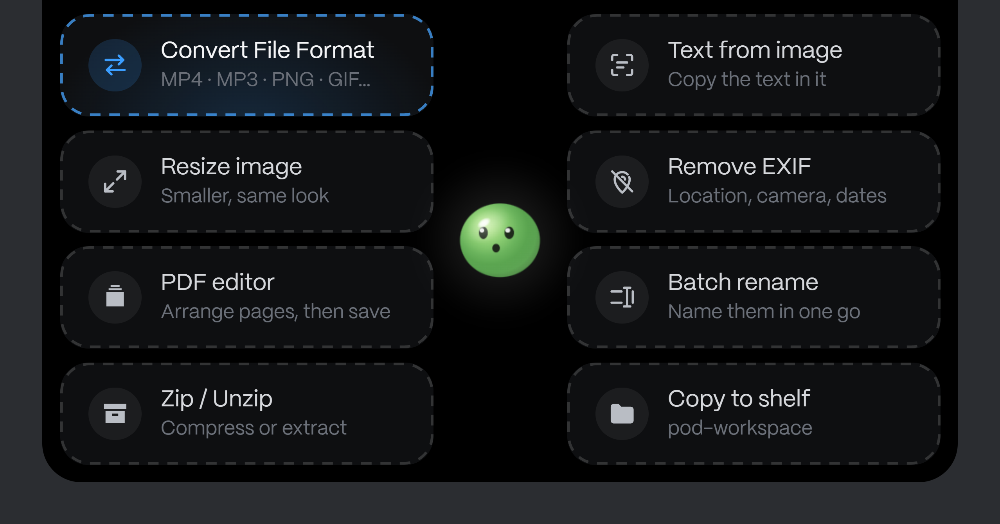
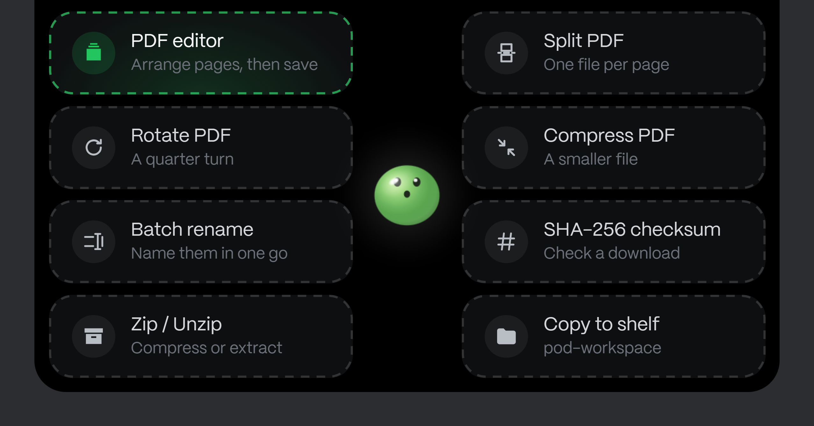
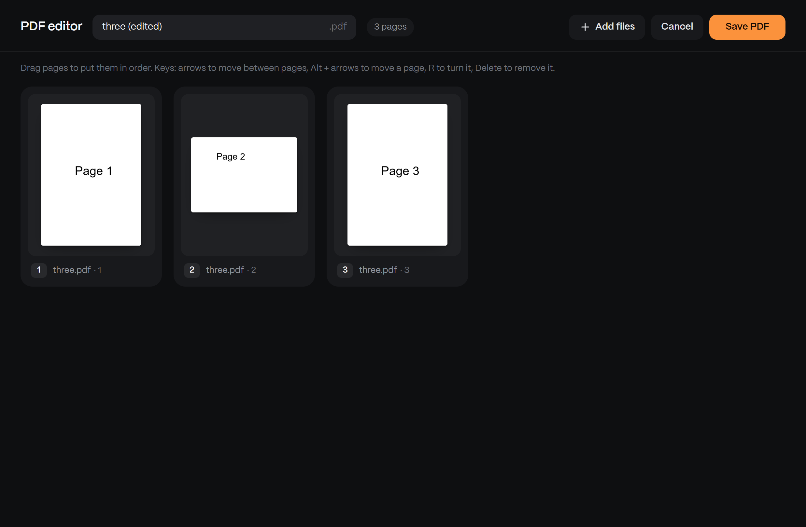
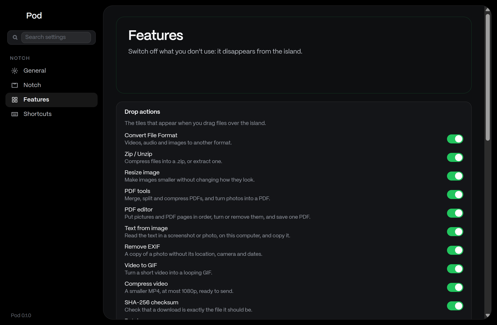

# Pod

**A notch island at the top of your screen, for Windows and Linux.**

Pod puts a small island at the top of your screen, with Stew, a glossy green
ball, in the middle. It is a temporary workspace: drag files over it and drop
them on an action (convert, zip, resize, PDF tools, the PDF editor, copy to the
shelf), keep files on the shelf and drag copies back out, set reminders and
deadlines that count down in the notch, and see live items take turns beside
Stew. Everything runs locally: no API keys, no accounts, and 0 % CPU while the
island is hidden.

Version 0.1.0 · Windows 10/11 · Linux (partial) · [Tauri 2](https://tauri.app) + Rust

<p align="center">
  
</p>

## How to use Pod

### Drop a file on an action

1. Drag one or more files from Explorer, your desktop or a browser towards
   the top of the screen. The island opens on tiles that fit what you are
   dragging: pictures get **Resize** and **Text from image**, PDFs get
   **Split** and **Compress**, videos get **Video to GIF**, and so on.
2. Let go on a tile. Pod works on a copy and puts the result on the
   **shelf**. Your original is never changed or overwritten.

<p align="center">
  
</p>

### Arrange PDF pages with the PDF editor

Drop pictures, PDFs or both on **PDF editor**. The Pod window opens with
every page as a card:

- **Drag** a card to move it, or use **Alt + arrow keys**.
- **R** turns a page a quarter turn (**Shift + R** the other way),
  **Delete** removes it (with **Undo**).
- **Add files** (or drop more files onto the window) adds pages; pictures
  dragged straight out of a web page work too.
- Name the file and press **Save PDF**: the new PDF lands on the shelf and the
  window closes. **Cancel** throws the arrangement away.

<p align="center">
  
</p>

### Keep files on the shelf

Open the island (move the pointer to the top of the screen and click it) and
choose the **Shelf** tab. It shows the files in your shelf folder in one row of
six; scroll sideways for more. Drag a file out to drop a copy wherever you are
working. The shelf folder is `~/Pod Shelf` unless you choose another one in
Settings.

### Reminders, notes and tools

- **Reminders**: type "call Sam at 4pm" or "essay in 3 days". The due reminder,
  or the nearest deadline as a countdown, shows on the left of the compact
  notch.
- **Notes**: plain-text notes, saved as `.md` files on the shelf.
- **Tools**: screenshot to shelf, focus timer, smart clipboard (JSON, JWT,
  Base64, Unix time…) and the dev servers running on this computer.

### Choose what Pod shows

Open **Settings** from the tray icon or the gear in the island. Every drop
action, tab, tool and live item has its own switch, and what you switch off
disappears from the island.

<p align="center">
  
</p>

## Features

- **Drop actions.** Drag files over the island and tiles appear:
  - **Convert File Format**: video, audio and images, with ffmpeg.
  - **Zip / Unzip**.
  - **Resize image**.
  - **PDF tools**: merge, split, rotate, compress, photos → PDF.
  - **PDF editor**: put pictures and PDF pages in order, turn or remove them,
    and save one PDF.
  - **Text from image** (Windows), **Remove EXIF**, **Video to GIF**,
    **Compress video**, **SHA-256 checksum**, **Batch rename**.
  - **Copy to shelf**.

  What an action makes is saved on the shelf. Originals are never
  overwritten (Batch rename renames in place, with Undo), and only files you
  actually dropped can be touched.
- **Shelf.** The files in your shelf folder, with thumbnails, in one row that
  scrolls sideways. Drag one out to drop a copy wherever you are working.
- **Reminders and deadlines** on the left of the compact notch.
- **Live items on the right of the notch**, taking turns:
  - now playing;
  - system glance (CPU, memory, battery);
  - camera and microphone in use (Windows);
  - the next meeting, from `.ics` / webcal links you paste;
  - new downloads;
  - dev servers running on this computer;
  - the focus timer.
- **Self-repair.** Pod checks itself at launch and every few hours while you
  are away (the shelf folder, settings, the ffmpeg it downloaded, its own
  leftovers) and fixes what it safely can; Settings → General → Health shows
  the result. If the WebView2
  runtime Windows needs is broken, Pod says so and offers Windows' own repair
  instead of failing silently. A Pod window whose page crashes reloads itself.
- **Everything can be switched off in Settings.** What is off disappears from
  the island.
- **Local-first.** No telemetry, no accounts, no keys. The network is used only
  for the calendar links you add, the ffmpeg download you ask for (checked
  against its published SHA-256), and the update check once you allow it.
- **14 languages**, switched without a restart.

Linux support is partial: the island, drop actions, shelf and tabs work, but
some live items have no Linux source yet (camera and microphone in use), ffmpeg
comes from your package manager, and less is tested than on Windows. See
[windows/README.md](windows/README.md#linux).

## Install

There are no published releases yet: Pod still carries an asset from Coucou
that may not be redistributed (see [LICENSE-ASSETS.md](LICENSE-ASSETS.md)).
Until that is replaced, build the installer yourself; it is the same one a
release would ship.

You need [Rust](https://rustup.rs) and [Node 20+](https://nodejs.org) (on
Windows, the MSVC build tools; on Linux, WebKitGTK and gtk-layer-shell, listed
in [windows/README.md](windows/README.md#linux)).

```bash
git clone https://github.com/umesh-404/pod.git
cd pod/windows
npm install
npm run pack
```

`npm run pack` writes the versioned packages to `windows/release/`:

| Platform | File | What it is |
|---|---|---|
| Windows | `Pod-Windows-0.1.0-setup.exe` | Installer for your user account (no admin rights needed) |
| Windows | `Pod-Windows-0.1.0.msi` | MSI package, for managed installs |
| Linux | `Pod-Linux-0.1.0-x86_64.AppImage`, `.deb`, `.rpm` | Built on Linux |

Run the setup file, then find Pod in the tray. Windows may show SmartScreen
for an unsigned installer: **More info → Run anyway**. Pod needs the Microsoft
Edge WebView2 Runtime, which Windows 10 and 11 already have.

### Updates

Once you allow it (Pod asks once, or Settings → General → Updates), Pod looks
for a newer Windows release on GitHub at launch and every 6 hours. When there
is one, it downloads the same kind of installer you installed, checks it
against the SHA-256 GitHub publishes, and, with **Install updates
automatically** on, installs it while you are away and starts Pod again (or
installs it when you click the card in the island).

An update replaces only the app's files. Your settings, reminders and notes
(`%APPDATA%\Pod`), the shelf folder and everything in it, and the ffmpeg Pod
downloaded all stay as they are.

### Publishing a release (maintainers)

1. Raise the version in `windows/package.json`, `windows/src-tauri/tauri.conf.json`
   and `windows/Cargo.toml`, and add its CHANGELOG section and What's
   new entry.
2. Push a tag `windows-vX.Y.Z` on that commit. The Windows workflow checks the
   versions agree, builds the installers and publishes the GitHub release;
   copies of Pod already installed pick it up on their next check.

## Develop

```bash
cd windows
npm install
npm run tauri dev      # development build
npx tsc --noEmit && npm test   # front-end checks and tests
cargo test --workspace         # Rust tests
```

How Pod works (the drop pipeline, the shelf folder, the PDF editor, the
ffmpeg download, self-repair, efficiency, platform differences, project
layout) is in [windows/README.md](windows/README.md). Changes are listed in
[CHANGELOG.md](CHANGELOG.md).

## Credits

Pod is a fork of [Coucou](https://github.com/Louis-CFM/coucou) by Louis Raillé,
released under the MIT License. The island and much of the app's foundation
come from Coucou. Stew, Pod's character, is Pod's own.

## License

The source code is under the [MIT License](LICENSE). The app and tray icons and
the sounds are Pod's own, under the same license. What is not covered by it is
listed in [LICENSE-ASSETS.md](LICENSE-ASSETS.md).
